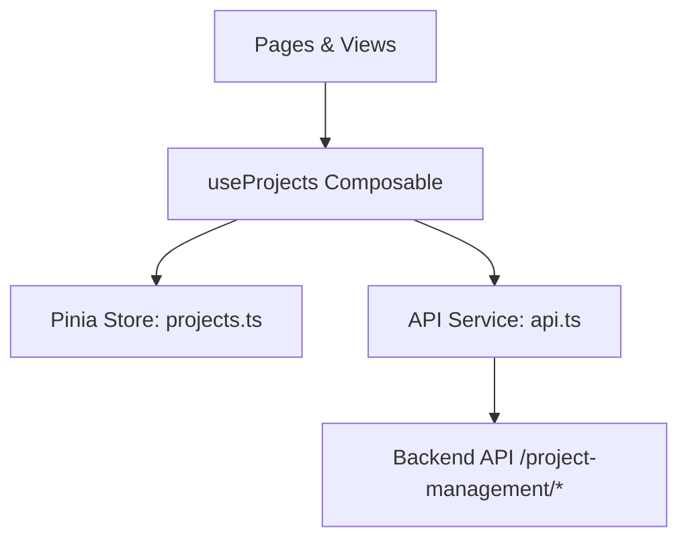

# Project Management Frontend Module Documentation

This document outlines the architecture, components, state management, and implementation details of the Project Management frontend module in Aligno.

---

## 1. Core Architecture

The Project Management module follows a layered architecture leveraging Nuxt 3's built-in file-based routing and composable patterns, alongside Pinia for global state management.



### Key Technologies Used:
- **UI & Framework**: Nuxt 3, Vue 3, Tailwind CSS v4.
- **Drag & Drop**: `@formkit/drag-and-drop/vue` (Group-based multi-list transfers).
- **State Management**: Pinia Store (`app/stores/projects.ts`).
- **Icons**: Nuxt Icon framework (`heroicons:*`).
- **Styling**: Midnight Obsidian (glass cards, dark container surfaces, cyan glow accents).

---

## 2. File and Component Structure

### Pages
- **`/projects`** ([index.vue](file:///home/badr-eddine-slaoui/Documents/Aligno/app/pages/projects/index.vue)):
  Displays list of projects with search, tab filters (Active, Archived, All), and pagination.
- **`/projects/[id]`** ([index.vue](file:///home/badr-eddine-slaoui/Documents/Aligno/app/pages/projects/%5Bid%5D/index.vue)):
  Project detail dashboard displaying overall progress gauge, task breakdowns (completed, in progress, overdue), active project members, and team invitation functionality.
- **`/projects/[id]/board`** ([board.vue](file:///home/badr-eddine-slaoui/Documents/Aligno/app/pages/projects/%5Bid%5D/board.vue)):
  The Kanban workspace displaying columns, cards, and handles drag-and-drop reorders/transfers.

### Components
- **`app/components/projects/`**
  - [ProjectCard.vue](file:///home/badr-eddine-slaoui/Documents/Aligno/app/components/projects/ProjectCard.vue): Displays color accent stripe, description, progress bar, due date, member avatars, and project action dropdown (edit, delete, archive).
  - [CreateProjectModal.vue](file:///home/badr-eddine-slaoui/Documents/Aligno/app/components/projects/CreateProjectModal.vue): Glass-styled modal for creating projects.
  - [EditProjectModal.vue](file:///home/badr-eddine-slaoui/Documents/Aligno/app/components/projects/EditProjectModal.vue): Modal pre-filled to modify project attributes.
- **`app/components/kanban/`**
  - [KanbanColumn.vue](file:///home/badr-eddine-slaoui/Documents/Aligno/app/components/kanban/KanbanColumn.vue): Container for cards. Implements FormKit drag-and-drop, inline rename input, delete action, and quick task creation input.
  - [KanbanCard.vue](file:///home/badr-eddine-slaoui/Documents/Aligno/app/components/kanban/KanbanCard.vue): Individual card component visualizing priority, due dates, tags, and assignee avatar.
  - [CardDetailModal.vue](file:///home/badr-eddine-slaoui/Documents/Aligno/app/components/kanban/CardDetailModal.vue): Large modal detail side-sheet to manage title, priority, due date, assignee, description, labels, and subtask checklist.
  - [LabelManager.vue](file:///home/badr-eddine-slaoui/Documents/Aligno/app/components/kanban/LabelManager.vue): Interface to create, edit, delete, and toggle project labels for specific cards.

---

## 3. Drag & Drop Architecture (`@formkit/drag-and-drop`)

The Kanban board relies on a group-based drag-and-drop system. Each column initializes a unique instance of `useDragAndDrop` using `@formkit/drag-and-drop/vue` pointing to its own reactive list of cards.

### Drag Configuration
```typescript
const [parent, cards] = useDragAndDrop(cardsList, {
  group: 'cards', // shared group ID allows transferring items between columns
  plugins: [animations()], // smooth transitions
  onTransfer(data) {
    emit('transfer', data) // Emitted to board.vue to PUT to backend
  },
  onSort(data) {
    emit('sort', data) // Emitted to board.vue to PUT to backend
  }
})
```

By specifying the same `group: 'cards'`, columns can exchange cards. The library updates the underlying reactive arrays automatically, and coordinates standard animations.

---

## 4. API Endpoints Covered

All routes are fully integrated inside the `projects` API namespace in [api.ts](file:///home/badr-eddine-slaoui/Documents/Aligno/app/services/api.ts):

- **Projects**:
  - `GET /api/project-management/projects`
  - `POST /api/project-management/projects`
  - `GET /api/project-management/projects/:id`
  - `PUT /api/project-management/projects/:id`
  - `DELETE /api/project-management/projects/:id`
  - `PUT /api/project-management/projects/:id/archive`
  - `GET /api/project-management/projects/:id/progress`
- **Columns**:
  - `POST /api/project-management/projects/:projectId/columns`
  - `PUT /api/project-management/columns/:columnId`
  - `DELETE /api/project-management/columns/:columnId`
  - `PUT /api/project-management/projects/:projectId/columns/reorder`
- **Cards (Tasks)**:
  - `POST /api/project-management/columns/:columnId/cards`
  - `GET /api/project-management/cards/:cardId`
  - `PUT /api/project-management/cards/:cardId`
  - `DELETE /api/project-management/cards/:cardId`
  - `PUT /api/project-management/cards/:cardId/move`
  - `PUT /api/project-management/columns/:columnId/cards/reorder`
  - `PUT /api/project-management/cards/:cardId/labels`
- **Labels & Subtasks**:
  - `POST /api/project-management/projects/:projectId/labels`
  - `PUT /api/project-management/labels/:labelId`
  - `DELETE /api/project-management/labels/:labelId`
  - `POST /api/project-management/cards/:cardId/subtasks`
  - `PUT /api/project-management/subtasks/:subtaskId`
  - `DELETE /api/project-management/subtasks/:subtaskId`
- **Members**:
  - `POST /api/project-management/projects/:projectId/members/invite`
  - `GET /api/project-management/projects/:projectId/members`
- **Notifications**:
  - `GET /api/project-management/notifications`
  - `PUT /api/project-management/notifications/:id/read`
  - `PUT /api/project-management/notifications/read-all`
