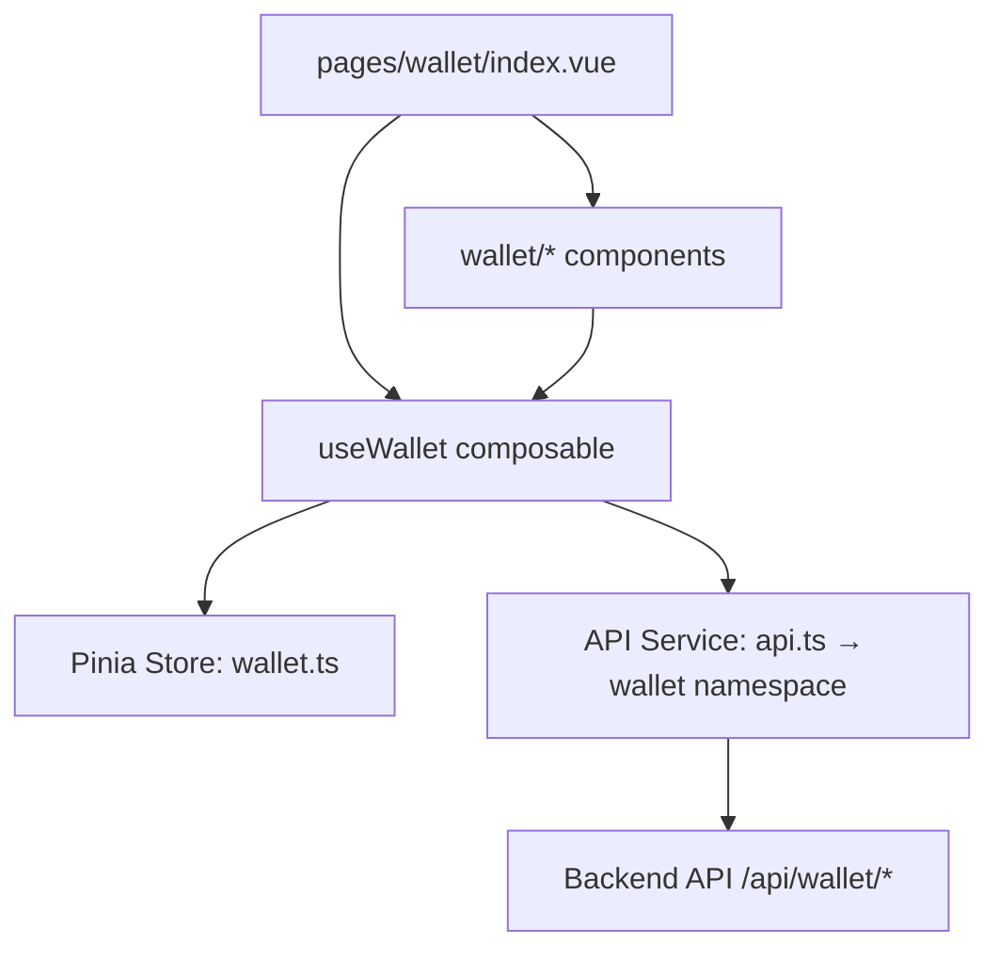

# Wallet Frontend Module Documentation

This document describes the frontend implementation of the personal finance management module for **Aligno**. It serves as the source of truth for the architecture, views, components, state management, and API integration on the client side.

---

## 1. Directory Structure

The frontend wallet module spans the following files:

```
app/
├── pages/
│   └── wallet/
│       └── index.vue                          # Financial Center page (thin orchestrator)
├── components/
│   └── wallet/
│       ├── WalletAccountCard.vue              # Individual bank account card (select/edit/delete)
│       ├── WalletAccountModal.vue             # Create / edit bank account form modal
│       ├── WalletTransactionTable.vue         # Transactions tab with search & category filter
│       ├── WalletTransactionModal.vue         # Add / edit transaction form modal
│       ├── WalletSubscriptionGrid.vue         # Subscriptions grid with paid toggle
│       ├── WalletSubscriptionModal.vue        # Add / edit subscription form modal
│       ├── WalletBudgetTab.vue                # Budget tracker + 6-month spending chart
│       ├── WalletBudgetModal.vue              # Set / update monthly budget modal
│       └── WalletDeleteConfirm.vue            # Shared danger confirmation modal
├── composables/
│   └── useWallet.ts                           # All wallet API calls + notification feedback
├── stores/
│   └── wallet.ts                              # Pinia store — wallet global state
├── services/
│   └── api.ts                                 # wallet namespace (bank-accounts, transactions, subscriptions, budget)
└── types/
    └── index.ts                               # BankAccount, Transaction, Subscription, Budget, MonthlyChartItem
```

---

## 2. Core Architecture

The Wallet module follows the same layered architecture as the rest of Aligno.



### Key Technologies Used
- **UI & Framework**: Nuxt 4, Vue 3, Tailwind CSS v4.
- **State Management**: Pinia Store (`app/stores/wallet.ts`).
- **Icons**: Nuxt Icon framework (`heroicons:*`).
- **Styling**: Midnight Obsidian design system — glass cards, dark container surfaces, cyan glow accents (`primary-container`, `surface-container-low`, `glass`).

---

## 3. Page Overview

### `/wallet` (`pages/wallet/index.vue`)

The Financial Center page is a **thin orchestrator** (~150 lines). It holds no form state itself — it delegates all rendering to the wallet components and all data access to `useWallet`.

**Responsibilities:**
- Initializes data on mount (`fetchBankAccounts`, `fetchMonthlyChart`, `fetchTransactions`, `fetchSubscriptions`).
- Watches `activeAccountId` to reload transactions and subscriptions on account switch.
- Controls modal open/close state and routes submit/delete events to the composable.
- Computes `netWorth` (grouped by currency) and current month `spending`/`budget` from `monthlyChart`.
- Renders the 3-tab layout: **Transactions**, **Subscriptions**, **Budgets & Charts**.

---

## 4. Component Overview

### `WalletAccountCard.vue`
Renders a single bank account as a glassmorphism card.

| Prop | Type | Description |
|---|---|---|
| `account` | `BankAccount` | The account to display |
| `isActive` | `boolean` | Whether this account is currently selected |

**Emits:** `select(id)`, `edit(account)`, `delete(id)`

- Highlights the active account with a cyan glow ring and `border-primary-container/80`.
- Shows balance in `font-display font-black text-2xl text-primary-container`.
- Edit and delete icon buttons are inside the card, stop-propagation from the select click.

---

### `WalletAccountModal.vue`
Create or edit a bank account.

| Prop | Type | Description |
|---|---|---|
| `modelValue` | `boolean` | Controls visibility |
| `account` | `BankAccount \| null` | Pre-fills form when editing |
| `loading` | `boolean` | Shows spinner on submit button |

**Emits:** `update:modelValue`, `submit(payload)`

- Detects edit mode from `!!account` prop.
- `balance` field is hidden when editing (balance is managed exclusively through transactions).
- Resets form reactively on `modelValue` open via `watch`.

---

### `WalletTransactionTable.vue`
Displays the transaction list for the active account.

| Prop | Type | Description |
|---|---|---|
| `transactions` | `Transaction[]` | Full list from store |
| `currency` | `string` | Active account currency for display |

**Emits:** `edit(tx)`, `delete(id)`

- Internally manages `searchQuery` and `categoryFilter` — the parent page has no filter state.
- `filtered` computed: search by description/category + filter by category + sort by date descending.
- Unique categories are extracted from the prop list dynamically for the filter select.
- INCOME rows are `text-emerald-400`, EXPENSE rows are `text-rose-400`.
- Uses `AppBadge` for the status pill.

---

### `WalletTransactionModal.vue`
Add or edit a transaction.

| Prop | Type | Description |
|---|---|---|
| `modelValue` | `boolean` | Controls visibility |
| `transaction` | `Transaction \| null` | Pre-fills form when editing |
| `bankAccountId` | `string` | Injected for create payload |
| `loading` | `boolean` | Shows spinner on submit button |

**Emits:** `update:modelValue`, `submit(payload)`

- EXPENSE / INCOME toggle with `heroicons:arrow-trending-down` / `heroicons:arrow-trending-up` icons.
- `bankAccountId` is only included in the emitted payload on create (not on edit).

---

### `WalletSubscriptionGrid.vue`
Displays recurring subscriptions for the active account in a 2-column card grid.

| Prop | Type | Description |
|---|---|---|
| `subscriptions` | `Subscription[]` | Full list from store |
| `currency` | `string` | Active account currency |

**Emits:** `edit(sub)`, `delete(id)`, `togglePaid(sub)`

- Each card shows name, category badge, payment method badge, start/end dates, amount, and an interactive paid/unpaid toggle button.
- Paid toggle is styled: emerald when paid, amber when unpaid — clicking emits `togglePaid` to the parent which calls `updateSubscription`.

---

### `WalletSubscriptionModal.vue`
Add or edit a subscription.

| Prop | Type | Description |
|---|---|---|
| `modelValue` | `boolean` | Controls visibility |
| `subscription` | `Subscription \| null` | Pre-fills form when editing |
| `bankAccountId` | `string` | Injected for create payload |
| `loading` | `boolean` | Shows spinner on submit button |

**Emits:** `update:modelValue`, `submit(payload)`

- Same EXPENSE/INCOME toggle with trending icons as the transaction modal.
- `isPaid` uses a **custom styled checkbox** (not a native input) consistent with the glass design system — green filled with a check icon when active.
- `endDate` is optional — mapped to `undefined` if empty.

---

### `WalletBudgetTab.vue`
Full budget tracker and 6-month spending vs budget chart.

| Prop | Type | Description |
|---|---|---|
| `monthlyChart` | `MonthlyChartItem[]` | Chart data from store |
| `currentMonthSpending` | `number` | Computed in parent from chart |
| `currentMonthBudget` | `number` | Computed in parent from chart |
| `currency` | `string` | Active account currency |

**Emits:** `setBudget`, `deleteBudget`

- Progress bar turns red (`from-red-500 to-rose-600`) when spending exceeds budget.
- Alert banner is shown with 3 states: `error` (over budget ⚠️), `warning` (≥90% 🔔), `success` (under budget ✅).
- Bar chart renders side-by-side bars (spending + budget) per month with hover tooltips.
- Bar heights are normalized against `maxChartValue` to scale proportionally.
- Spending bars turn red when they exceed the budget limit for that month.

---

### `WalletBudgetModal.vue`
Set or update the monthly budget limit (upsert).

| Prop | Type | Description |
|---|---|---|
| `modelValue` | `boolean` | Controls visibility |
| `currentAmount` | `number` | Pre-fills amount from active month |
| `loading` | `boolean` | Shows spinner on submit button |

**Emits:** `update:modelValue`, `submit({ amount, month, year })`

- Month and year auto-populated with current date on open.
- Helper hint below month/year explains the upsert behavior.

---

### `WalletDeleteConfirm.vue`
Shared danger confirmation dialog used for all delete operations (account, transaction, subscription, budget).

| Prop | Type | Description |
|---|---|---|
| `modelValue` | `boolean` | Controls visibility |
| `loading` | `boolean` | Shows spinner on confirm button |

**Emits:** `update:modelValue`, `confirm`

- Displays a `heroicons:exclamation-triangle` icon inside a `bg-error-container/10` warning box.
- The word "permanent" is highlighted in `text-error font-semibold`.

---

## 5. State Management (`stores/wallet.ts`)

The Pinia store uses the **Composition API style** (`defineStore` with a setup function).

### State

| Ref | Type | Description |
|---|---|---|
| `bankAccounts` | `BankAccount[]` | All accounts for the authenticated user |
| `activeAccountId` | `string \| null` | Currently selected account ID |
| `transactions` | `Transaction[]` | Transactions for the active account |
| `subscriptions` | `Subscription[]` | Subscriptions for the active account |
| `budgets` | `Budget[]` | All budgets for the user |
| `monthlyChart` | `MonthlyChartItem[]` | 6-month spending chart data |
| `isLoading` | `boolean` | Global loading flag for the wallet module |

### Getter

| Computed | Type | Description |
|---|---|---|
| `activeAccount` | `BankAccount \| null` | Derives the full account object from `activeAccountId` |

### Actions

| Action | Description |
|---|---|
| `setBankAccounts(accounts)` | Sets all accounts; auto-selects first if none active or active ID no longer exists |
| `setActiveAccountId(id)` | Changes the selected account |
| `upsertBankAccount(account)` | Inserts or updates a single account in place |
| `removeBankAccount(id)` | Removes account; falls back to first remaining |
| `setTransactions(list)` | Replaces transaction list |
| `upsertTransaction(tx)` | Inserts at head (new) or updates in place (edit) |
| `removeTransaction(id)` | Filters out a transaction by ID |
| `setSubscriptions(list)` | Replaces subscription list |
| `upsertSubscription(sub)` | Inserts or updates a subscription in place |
| `removeSubscription(id)` | Filters out a subscription by ID |
| `setBudgets(list)` | Replaces budgets list |
| `upsertBudget(budget)` | Upserts by `(month, year)` key |
| `removeBudget(month, year)` | Removes budget matching the `(month, year)` pair |
| `setMonthlyChart(chart)` | Replaces chart data |

---

## 6. Composable (`composables/useWallet.ts`)

`useWallet` is the single interface between the page/components and both the Pinia store and the API service. It wraps every API call with:
- `store.isLoading = true / false` around each call.
- `notifications.success(...)` / `notifications.error(...)` via `useNotifications`.
- Calls the relevant store mutation on success.
- Re-throws on error so the page can catch and suppress the modal if needed.

### Exposed methods

**Bank Accounts**
- `fetchBankAccounts()` → `GET /api/wallet/bank-accounts`
- `createBankAccount(payload)` → `POST /api/wallet/bank-accounts`
- `updateBankAccount(id, payload)` → `PUT /api/wallet/bank-accounts/:id`
- `deleteBankAccount(id)` → `DELETE /api/wallet/bank-accounts/:id`
- `setActiveAccountId(id)` → store only, no API call

**Transactions**
- `fetchTransactions(accountId)` → `GET /api/wallet/transactions?bankAccountId=`
- `createTransaction(payload)` → `POST /api/wallet/transactions` + re-fetches accounts (balance update)
- `updateTransaction(id, payload)` → `PUT /api/wallet/transactions/:id` + re-fetches accounts
- `deleteTransaction(id)` → `DELETE /api/wallet/transactions/:id` + re-fetches accounts

**Subscriptions**
- `fetchSubscriptions(accountId)` → `GET /api/wallet/subscriptions?bankAccountId=`
- `createSubscription(payload)` → `POST /api/wallet/subscriptions`
- `updateSubscription(id, payload)` → `PUT /api/wallet/subscriptions/:id`
- `deleteSubscription(id)` → `DELETE /api/wallet/subscriptions/:id`

**Budget**
- `fetchBudgets()` → `GET /api/wallet/budget`
- `fetchBudget(month, year)` → `GET /api/wallet/budget/month?month=&year=`
- `setBudget(payload)` → `POST /api/wallet/budget` (upsert)
- `deleteBudget(month, year)` → `DELETE /api/wallet/budget/month?month=&year=`
- `fetchMonthlyChart(months?)` → `GET /api/wallet/budget/chart?months=` (default 6)

> **Note:** After every create/update/delete, the page calls `wallet.fetchMonthlyChart()` to keep the budget tracker and chart in sync.

---

## 7. API Endpoints Covered

All routes are integrated in the `wallet` namespace inside `app/services/api.ts`:

### Bank Accounts
| Method | Endpoint | Description |
|---|---|---|
| `GET` | `/api/wallet/bank-accounts` | List all accounts for current user |
| `POST` | `/api/wallet/bank-accounts` | Create a new bank account |
| `GET` | `/api/wallet/bank-accounts/:id` | Get a single account |
| `PUT` | `/api/wallet/bank-accounts/:id` | Update account details |
| `DELETE` | `/api/wallet/bank-accounts/:id` | Delete account (cascades transactions & subscriptions) |

### Transactions
| Method | Endpoint | Description |
|---|---|---|
| `GET` | `/api/wallet/transactions?bankAccountId=` | List transactions for an account |
| `POST` | `/api/wallet/transactions` | Create transaction (updates balance atomically) |
| `GET` | `/api/wallet/transactions/:id` | Get a single transaction |
| `PUT` | `/api/wallet/transactions/:id` | Update transaction (auto-corrects balance) |
| `DELETE` | `/api/wallet/transactions/:id` | Delete transaction (rolls back balance) |

### Subscriptions
| Method | Endpoint | Description |
|---|---|---|
| `GET` | `/api/wallet/subscriptions?bankAccountId=` | List subscriptions for an account |
| `POST` | `/api/wallet/subscriptions` | Create a subscription |
| `GET` | `/api/wallet/subscriptions/:id` | Get a single subscription |
| `PUT` | `/api/wallet/subscriptions/:id` | Update a subscription |
| `DELETE` | `/api/wallet/subscriptions/:id` | Delete a subscription |

### Budget
| Method | Endpoint | Description |
|---|---|---|
| `GET` | `/api/wallet/budget` | List all budgets for current user |
| `POST` | `/api/wallet/budget` | Set / upsert budget for a month |
| `GET` | `/api/wallet/budget/month?month=&year=` | Get budget for a specific month |
| `DELETE` | `/api/wallet/budget/month?month=&year=` | Delete budget for a specific month |
| `GET` | `/api/wallet/budget/chart?months=6` | Monthly spending vs budget chart data |

---

## 8. TypeScript Types (`types/index.ts`)

```typescript
interface BankAccount {
  id: string
  name: string
  bankName: string | null
  accountNumber: string | null
  balance: number          // auto-managed by transaction mutations
  currency: string         // 3-letter code e.g. "MAD"
  userId: string
  createdAt: string
  updatedAt: string
}

type TransactionStatus = 'INCOME' | 'EXPENSE'

interface Transaction {
  id: string
  status: TransactionStatus
  amount: number
  category: string
  description: string | null
  date: string
  bankAccountId: string
  createdAt: string
  updatedAt: string
}

interface Subscription {
  id: string
  name: string
  status: TransactionStatus
  amount: number
  category: string
  paymentMethod: string
  isPaid: boolean
  startDate: string
  endDate: string | null
  bankAccountId: string
  createdAt: string
  updatedAt: string
}

interface Budget {
  id: string
  amount: number
  month: number            // 1–12
  year: number
  userId: string
  createdAt: string
  updatedAt: string
}

interface MonthlyChartItem {
  month: number
  year: number
  transactions: number     // sum of EXPENSE transactions
  subscriptions: number    // sum of active EXPENSE subscriptions
  totalSpending: number    // transactions + subscriptions
  budget: number | null
  alert: string | null     // null | "⚠️ Budget limit reached..." | "🔔 Warning: 90%..."
}
```
