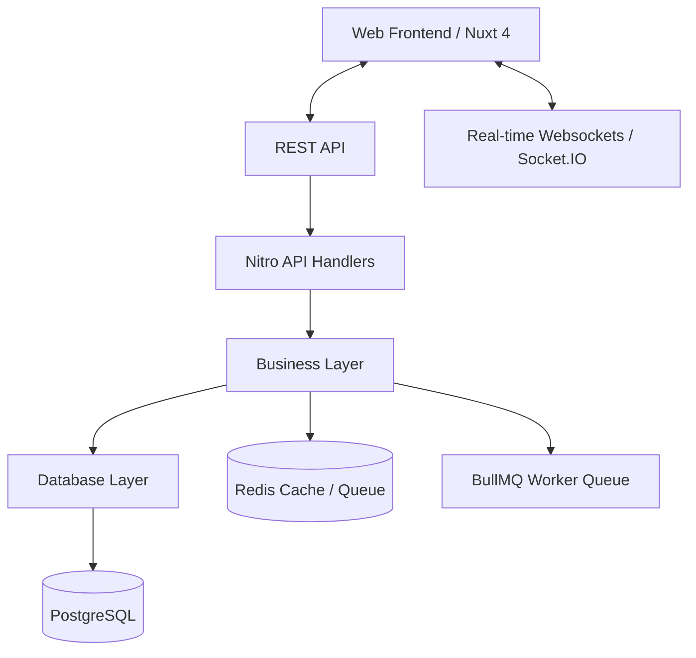

# Aligno v1.0 — High-Level Architecture Overview

Aligno is an all-in-one productivity and lifestyle management system designed to harmonize work, time, and finances.

---

## 1. System Topology

---

## 2. Core Modules

### 1. Authentication (`docs/AUTH.md`)
* Short-lived JWT access tokens.
* Secure HttpOnly refresh tokens in cookies.
* Email verification, recoveries, and profile customization.

### 2. Project Management (`docs/PROJECT_MANAGEMENT.md`)
* Project ownership, role permissions (`ADMIN`, `MEMBER`, `VISITOR`).
* Interactive Kanban boards.
* Real-time notifications and web sockets synchronization.
* Scheduled deadline reminders via BullMQ.

### 3. Time Management (`docs/TIME_MANAGEMENT.md`)
* Day blueprints (Templates) with custom time blocks.
* Daily schedule activation and real-time execution.

### 4. Wallet Module (`docs/WALLET.md`)
* Multiple accounts support.
* Expenses, income, subscription tracking, and budget alerts.
